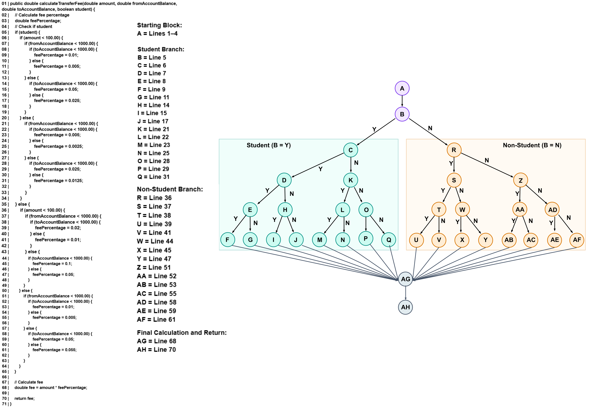

## Transfer: Basis Path Testing

### 1. Process and Assumptions

In this case, we used Basis Path Testing to examine the `calculateTransferFee()` method in `FeesCalculator.java`. We looked at the conditions in the Java code to create the Control Flow Graph (CFG).

For this analysis, we consider the following:
- The student and non-student paths are shown separately.
- Y represents True, and N represents False.
- A–AH represent the grouped code statements.
- Each decision has a Yes or No branch.
- All paths lead to the same fee calculation and return statement.

### 2. Control Flow Graph (CFG)

#### 2a. Numbered Code

The following code shows the `calculateTransferFee()` method with line numbers:

```text
01 | public double calculateTransferFee(double amount, double fromAccountBalance, double toAccountBalance, boolean student) {
02 |     // Calculate fee percentage
03 |     double feePercentage;
04 |     // Check if student
05 |     if (student) {
06 |         if (amount < 100.00) {
07 |             if (fromAccountBalance < 1000.00) {
08 |                 if (toAccountBalance < 1000.00) {
09 |                     feePercentage = 0.01;
10 |                 } else {
11 |                     feePercentage = 0.005;
12 |                 }
13 |             } else {
14 |                 if (toAccountBalance < 1000.00) {
15 |                     feePercentage = 0.05;
16 |                 } else {
17 |                     feePercentage = 0.025;
18 |                 }
19 |             }
20 |         } else {
21 |             if (fromAccountBalance < 1000.00) {
22 |                 if (toAccountBalance < 1000.00) {
23 |                     feePercentage = 0.005;
24 |                 } else {
25 |                     feePercentage = 0.0025;
26 |                 }
27 |             } else {
28 |                 if (toAccountBalance < 1000.00) {
29 |                     feePercentage = 0.025;
30 |                 } else {
31 |                     feePercentage = 0.0125;
32 |                 }
33 |             }
34 |         }
35 |     } else {
36 |         if (amount < 100.00) {
37 |             if (fromAccountBalance < 1000.00) {
38 |                 if (toAccountBalance < 1000.00) {
39 |                     feePercentage = 0.02;
40 |                 } else {
41 |                     feePercentage = 0.01;
42 |                 }
43 |             } else {
44 |                 if (toAccountBalance < 1000.00) {
45 |                     feePercentage = 0.1;
46 |                 } else {
47 |                     feePercentage = 0.05;
48 |                 }
49 |             }
50 |         } else {
51 |             if (fromAccountBalance < 1000.00) {
52 |                 if (toAccountBalance < 1000.00) {
53 |                     feePercentage = 0.01;
54 |                 } else {
55 |                     feePercentage = 0.005;
56 |                 }
57 |             } else {
58 |                 if (toAccountBalance < 1000.00) {
59 |                     feePercentage = 0.05;
60 |                 } else {
61 |                     feePercentage = 0.055;
62 |                 }
63 |             }
64 |         }
65 |     }
66 |
67 |     // Calculate fee
68 |     double fee = amount * feePercentage;
69 |
70 |     return fee;
71 | }
```

#### 2b. Grouped Blocks

In this case, we grouped the code statements into blocks A–AH:

**Starting Block**

```text
A = Lines 1–4
```

**Initial Decision**

```text
B = Line 5
```

**Student Branch**

```text
C = Line 6
D = Line 7
E = Line 8
F = Line 9
G = Line 11
H = Line 14
I = Line 15
J = Line 17
K = Line 21
L = Line 22
M = Line 23
N = Line 25
O = Line 28
P = Line 29
Q = Line 31
```

**Non-Student Branch**

```text
R = Line 36
S = Line 37
T = Line 38
U = Line 39
V = Line 41
W = Line 44
X = Line 45
Y = Line 47
Z = Line 51
AA = Line 52
AB = Line 53
AC = Line 55
AD = Line 58
AE = Line 59
AF = Line 61
```

**Final Calculation and Return**

```text
AG = Line 68
AH = Line 70
```

#### 2c. Control Flow Graph

Below is the CFG, which shows the different paths that the transfer method can follow



### 3. Cyclomatic Complexity

In this case, the `calculateTransferFee()` method has 15 decision blocks (P). We can use the following formula to calculate the Cyclomatic Complexity:

**V(G) = P + 1**

**V(G) = 15 + 1 = 16**

Therefore, the Cyclomatic Complexity is **16**, meaning we need 16 independent basis paths for testing.

### 4. Basis Paths

In this case, in the CFG, we separated the paths into 8 student paths and 8 non-student paths. following the grouped code statements, so we consider the following below:

**Student Basis Paths (P1–P8)**

| Path | Block Sequence | Fee Assignment Block |
|---|---|---|
| P1 | A → B → C → D → E → F → AG → AH | F |
| P2 | A → B → C → D → E → G → AG → AH | G |
| P3 | A → B → C → D → H → I → AG → AH | I |
| P4 | A → B → C → D → H → J → AG → AH | J |
| P5 | A → B → C → K → L → M → AG → AH | M |
| P6 | A → B → C → K → L → N → AG → AH | N |
| P7 | A → B → C → K → O → P → AG → AH | P |
| P8 | A → B → C → K → O → Q → AG → AH | Q |

**Non-Student Basis Paths (P9–P16)**

| Path | Block Sequence | Fee Assignment Block |
|---|---|---|
| P9 | A → B → R → S → T → U → AG → AH | U |
| P10 | A → B → R → S → T → V → AG → AH | V |
| P11 | A → B → R → S → W → X → AG → AH | X |
| P12 | A → B → R → S → W → Y → AG → AH | Y |
| P13 | A → B → R → Z → AA → AB → AG → AH | AB |
| P14 | A → B → R → Z → AA → AC → AG → AH | AC |
| P15 | A → B → R → Z → AD → AE → AG → AH | AE |
| P16 | A → B → R → Z → AD → AF → AG → AH | AF |

### 5. Transfer Test Cases

In this case, we created 16 test cases based on the independent basis paths identified in Section 4. Each test case follows a different path in the CFG and uses input values that satisfy the corresponding conditions. (In this case, the expected fees are calculated using the Assignment 2 specifications rather than the Java implementation), we can then consider the following below:

**Expected Fee = Amount × (Fee Percentage / 100)**

#### 5a. Student Test Cases (TC1–TC8)

| Test Case | Basis Path | Student | Amount ($) | From Balance ($) | To Balance ($) | Expected Fee (%) | Expected Fee ($) |
|---|---|---|---|---|---|---|---|
| TC1 | P1 | True | 50 | 675 | 825 | 0.1% | 0.05 |
| TC2 | P2 | True | 50 | 550 | 1350 | 0.05% | 0.025 |
| TC3 | P3 | True | 75 | 1875 | 925 | 0.5% | 0.375 |
| TC4 | P4 | True | 50 | 2450 | 1575 | 0.25% | 0.125 |
| TC5 | P5 | True | 100 | 725 | 850 | 0.05% | 0.05 |
| TC6 | P6 | True | 200 | 925 | 1000 | 0.025% | 0.05 |
| TC7 | P7 | True | 200 | 1000 | 575 | 0.25% | 0.50 |
| TC8 | P8 | True | 400 | 1750 | 2200 | 0.125% | 0.50 |

#### 5b. Non-Student Test Cases (TC9–TC16)

| Test Case | Basis Path | Student | Amount ($) | From Balance ($) | To Balance ($) | Expected Fee (%) | Expected Fee ($) |
|---|---|---|---|---|---|---|---|
| TC9 | P9 | False | 75 | 925 | 425 | 0.2% | 0.15 |
| TC10 | P10 | False | 50 | 700 | 1425 | 0.1% | 0.05 |
| TC11 | P11 | False | 75 | 1925 | 850 | 1% | 0.75 |
| TC12 | P12 | False | 50 | 1650 | 2075 | 0.5% | 0.25 |
| TC13 | P13 | False | 100 | 525 | 800 | 0.1% | 0.10 |
| TC14 | P14 | False | 200 | 850 | 1300 | 0.05% | 0.10 |
| TC15 | P15 | False | 300 | 1550 | 675 | 0.5% | 1.50 |
| TC16 | P16 | False | 200 | 2025 | 1450 | 0.25% | 0.50 |
